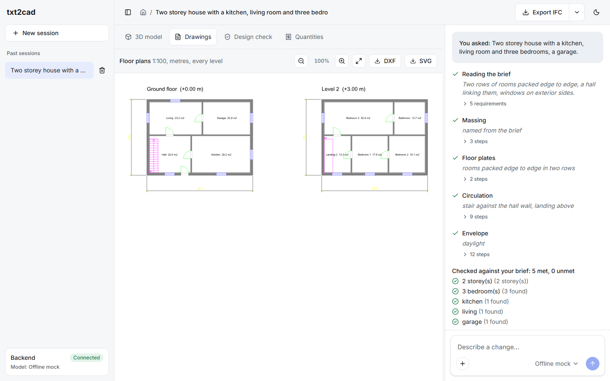

# txt2cad

**Describe a building in plain words. Watch it grow in 3D. Export IFC, DXF and STEP.**

txt2cad turns a sentence like *"two-storey house with a kitchen, a living room, three bedrooms and a garage"* into a real building model:
walls, floors, a roof, doors, windows and a stair, opened in a 3D viewer while an AI model is still working, then exported as an **IFC4**
BIM file, **DXF** floor plans, **STEP** solids and an **SVG** plan. You keep talking to it ("add a study next to the kitchen",
"make this window bigger" after clicking it) and every message becomes a new version you can go back to.

It runs on your own machine. The server listens on `127.0.0.1` only.


## The idea that makes it work

**The AI model never writes geometry.** IFC files are large graphs of numbered references, and language models are poor at keeping those
consistent, at wall offsets, and at boolean cuts for openings. So the model is given a small vocabulary of design moves instead:

> add a level, add a room as a rectangle on a grid, put a door between two rooms, put a window on the south wall, add a stair

and the application's own code turns those moves into walls, slabs, openings, a roof and a stair. Every file format is then written from
that one derived description, so the 3D model, the plans and the STEP file always agree to the millimetre.

```
 prompt (+ the element you clicked)
   -> requirements checklist                     what the brief asked for, checkable
   -> build steps, streamed as JSON              room, door, window, stair, roof ...
        each complete step: validate -> apply -> derive -> preview IFC -> 3D viewer
        a rejected step goes back to the model with a message it can act on
   -> check against the checklist, fix rounds    missing windows, unlinked rooms, no stair
   -> derive geometry -> IFC4 (stable GlobalIds) -> save version
   -> exports on demand: IFC, DXF, STEP, SVG, DWG (with a converter), JSON
```

## What you get

| | |
| --- | --- |
| **Prompt to model** | One sentence in, a valid IFC4 building out. Steps stream in and the model appears in the viewer as they land. |
| **Talk to it** | Follow-up prompts edit the building. Click an element in the 3D view and the next message is about *that* element. |
| **Versions** | Every prompt makes a version. Open any of them, restore one (history is never deleted), download any of them. |
| **Exports** | IFC4 for BIM tools, DXF plans (named layers, metres, door swings, dimensions, stair symbols), STEP solids for mechanical CAD, SVG plans, JSON of the design and geometry. DWG through an optional free converter. |
| **Drawings tab** | The floor plans of every level, drawn from the same document as the DXF download. |
| **Design check tab** | An indicative check against a few dwelling rules (exits, stair geometry, ceiling height, daylight, bedroom escape windows) with "show in model". It is labelled as indicative and is not a compliance report. |
| **Quantities tab** | Areas, volumes and counts straight from the geometry. It ships no prices; type your own rate per unit and the cost fills in. |
| **Section cut, camera views, light and dark themes** | Cut the model at any height, jump to top/front/iso views. |

| Home | Click to select |
| --- | --- |
|  |  |

| Plans | Design check |
| --- | --- |
|  |  |

## Quick start

You need Python 3.12 and Node 20 or newer.

**Backend**

```bash
cd backend
py -3.12 -m venv .venv                       # python3.12 -m venv .venv on macOS/Linux
.venv/Scripts/python -m pip install -r requirements.txt
.venv/Scripts/python -m app.main              # http://127.0.0.1:8770
```

**Frontend**

```bash
cd frontend
npm install                                   # also copies the web-ifc wasm into public/wasm
npm run dev                                   # http://127.0.0.1:5174
```

Open http://127.0.0.1:5174, pick a starter or type a sentence, press Enter. With no setup the **Offline mock** model is used: it needs no
network and understands storeys, bedroom counts and a few room words, which is enough to see the whole pipeline work.

## Choosing the AI model

The model picker in the prompt box lists profiles stored in the database (`llm_profiles`).

| Profile | Setup |
| --- | --- |
| **Offline mock** | None. Used by all the tests. It cannot edit an existing design. |
| **Gemini** | Put `GEMINI_API_KEY=...` in `backend/.env` (git-ignored) or in the environment and restart the backend. Uses the OpenAI-compatible endpoint with `gemini-2.5-flash` and `reasoning_effort: low`, which brings a build call from about 30 s to about 10 s. A two-storey house takes about 40 s, an edit about 30 s. |
| **Any OpenAI-compatible endpoint** | Ollama, llama.cpp server, vLLM, LM Studio. One adapter (`app/llm/openai_compat.py`) covers all of them. The key is read from an environment variable named in the profile, never stored in the database. |
| **Program planner (optional)** | Profile option `{"planner": "program"}` for small models that cannot place rooms: the model only lists the rooms per level, and code does the layout, doors, windows and stairs. |

## Exports

| Format | What it is | Notes |
| --- | --- | --- |
| IFC4 | BIM model | IfcOpenShell. Walls, slabs, roofs, stairs, doors and windows with real openings. GlobalIds survive edits, so an element that is still there keeps its id. |
| DXF R2018 | Floor plans | ezdxf. Layers `A-WALL`, `A-WALL-PATT`, `A-DOOR`, `A-GLAZ`, `A-AREA`, `A-AREA-IDEN`, `A-FLOR-STRS`, `A-ANNO-DIMS`. Metres. One drawing per level. |
| STEP | Solids | CadQuery / OpenCascade. Walls are cut by their openings with real boolean operations; every element is a named, coloured solid. |
| SVG | Plans as a picture | Rendered from the DXF document. |
| DWG | Autodesk drawing | DWG is proprietary and has no open writer. If the free ODA File Converter is installed (or `TXT2CAD_ODA_CONVERTER` points to it), the DXF is converted. Otherwise the menu entry is disabled with the reason. The DXF opens in AutoCAD anyway. |
| JSON | Design and geometry | The rooms as designed, and every element the files were built from. |

## Tech stack

| Layer | Choice |
| --- | --- |
| Backend | Python 3.12, FastAPI, pydantic v2, uvicorn |
| Geometry and CAD | IfcOpenShell 0.9 (IFC4), shapely, ezdxf, CadQuery (OpenCascade) |
| Database | SQLite in WAL mode, stdlib `sqlite3`, plain SQL ([schema](backend/app/db/schema.sql)) |
| AI | One `LLM.complete()` interface; adapters for the offline mock and any OpenAI-compatible endpoint (Gemini, Ollama, ...) |
| Streaming | Server-Sent Events over POST |
| Frontend | React 19, TypeScript 7, Vite 8, Tailwind CSS v4, Radix UI primitives, Lucide icons |
| 3D | That Open (`@thatopen/components`, `@thatopen/fragments`) on three.js, with `web-ifc` pinned to 0.0.77 |
| Tests | pytest (91 tests, no network), Vitest (7 tests), headless-browser checks of the main flows |

## Project layout

```
backend/
  app/domain/      design model, step vocabulary, derive (rooms -> walls, openings, stairs, roofs), checks
  app/ifc/         IFC4 compile with stable GlobalIds
  app/export/      DXF, STEP, SVG, DWG (converter plug-in)
  app/analysis/    design check and quantity take-off
  app/llm/         LLM interface, mock, OpenAI-compatible adapter, streaming JSON reader, prompts, program planner
  app/pipeline/    one run: requirements, streamed build, fix rounds, previews, save
  app/db/          schema and repositories (every query carries the owner)
  app/api/         HTTP routes
  tests/
frontend/
  src/ui/          design-system primitives (Button, Menu, Tabs, Composer, Trace, ...)
  src/app/         shell, home, workspace, viewer pane, assistant, analysis tabs
  src/viewer/      the only file that knows the 3D library's API
  src/api/         backend client with an SSE-over-POST reader
design/            design tokens (light and dark), generator, contrast checker, component specs
docs/              architecture, API, screenshots
```

## Tests

```bash
cd backend  && .venv/Scripts/python -m pytest        # 91 tests on the offline mock, no network
cd frontend && npm test                                # 7 tests
cd frontend && npx tsc --noEmit                        # type check
cd design   && python contrast.py tokens.json          # WCAG contrast of every text/background pair (also tokens.dark.json)
```

What the tests pin down: step validation and the messages sent back to the model, derive on shared edges and openings, stairs (riser,
tread, well in the slab above, direction), IFC geometry (units, tessellation, voids), GlobalId stability across edits, DXF audit and
entity counts, STEP re-import volumes and bounding boxes, concurrency (409 on a stale version), deletion cascades, and the streaming
reader on every prefix of a real reply.

## Current limits

- Rooms are rectangles on a grid. Curved walls, pitched roofs, balconies, porches and basements are reported as "not buildable yet"
  rather than silently dropped.
- One straight stair per storey, against a wall of a hall, with a landing above it.
- The design check covers a handful of dwelling rules in the style of the US IRC. It is a prompt to look, not an approval.
- Quantities have no prices built in, on purpose.
- Edits are verified with Gemini on simple requests (add a room, change a window). Large restructuring is covered by unit tests of the
  design operations, not yet by model runs.
- Small local models (1.5B) cannot plan a building through the step vocabulary; the program planner exists for them but is experimental.

## More

- [docs/architecture.md](docs/architecture.md): pipeline, data model, geometry rules, concurrency, decisions
- [docs/api.md](docs/api.md): HTTP routes and the event stream
- [design/components.md](design/components.md): component specifications
