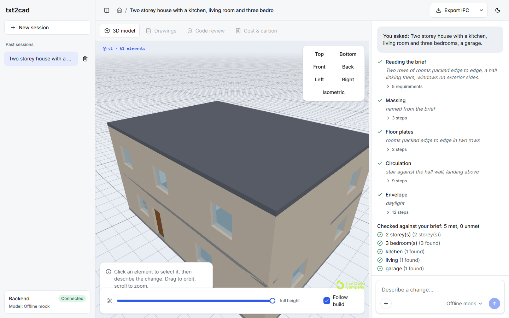
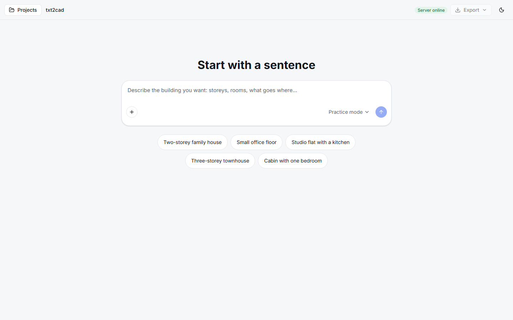
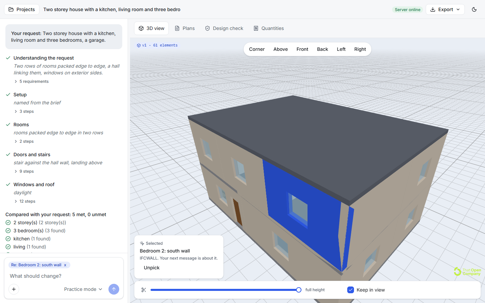
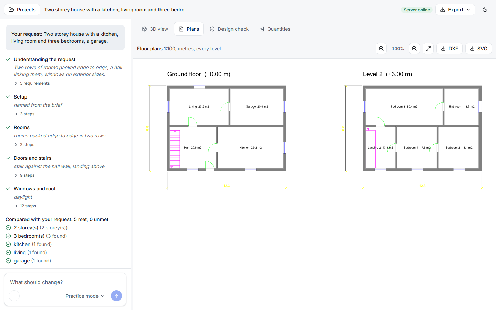
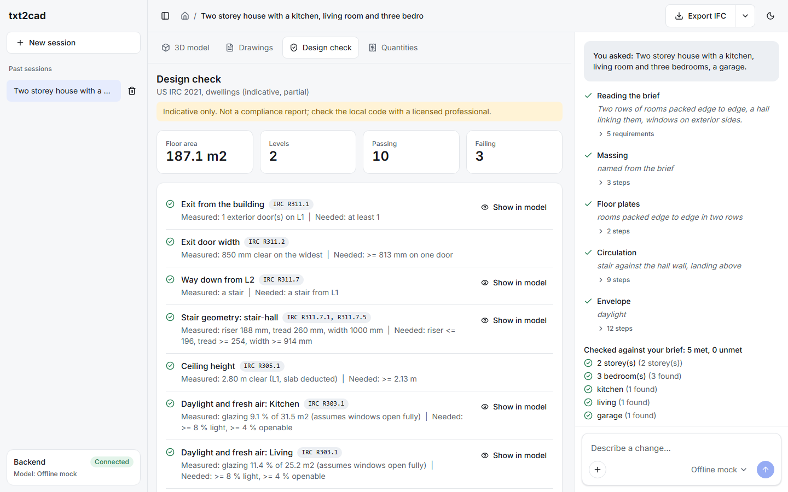
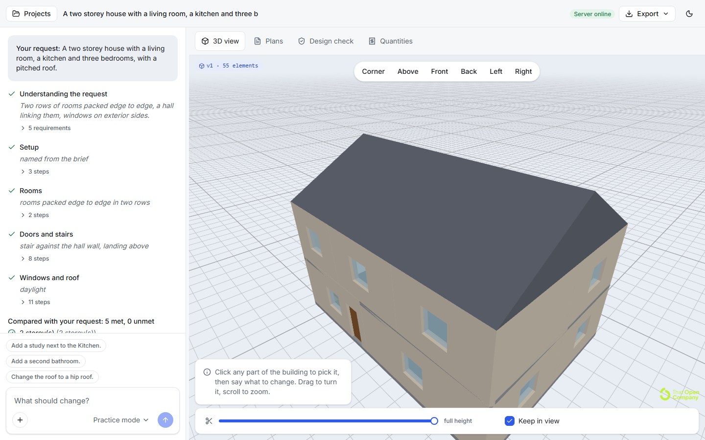
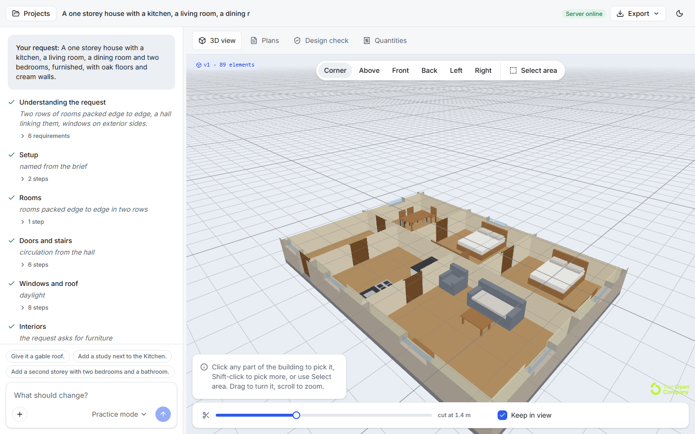

# txt2cad

**Describe a building in plain words. Watch it grow in 3D. Export IFC and DXF.**

txt2cad turns a sentence like *"two-storey house with a kitchen, a living room, three bedrooms and a garage"* into a real building model:
walls, floors, a roof, doors, windows and a stair, opened in a 3D viewer while an AI model is still working, then exported as an **IFC4**
BIM file, **DXF** floor plans and an **SVG** plan. You keep talking to it ("add a study next to the kitchen",
"make this window bigger" after clicking it) and every message becomes a new version you can go back to.

It runs on your own machine. The server listens on `127.0.0.1` only.



## The idea that makes it work

**The AI model never writes geometry.** IFC files are large graphs of numbered references, and language models are poor at keeping those
consistent, at wall offsets, and at boolean cuts for openings. So the model is given a small vocabulary of design moves instead:

> add a level, add a room as a rectangle on a grid, put a door between two rooms, put a window on the south wall, add a stair

and the application's own code turns those moves into walls, slabs, openings, a roof and a stair. Every file format is then written from
that one derived description, so the 3D model and the plans always agree to the millimetre.

```
 prompt (+ the element you clicked)
   -> requirements checklist                     what the brief asked for, checkable
   -> build steps, streamed as JSON              room, door, window, stair, roof ...
        each complete step: validate -> apply -> derive -> preview IFC -> 3D viewer
        a rejected step goes back to the model with a message it can act on
   -> check against the checklist, fix rounds    missing windows, unlinked rooms, no stair
   -> derive geometry -> IFC4 (stable GlobalIds) -> save version
   -> exports on demand: IFC, DXF, SVG, JSON
```

## What you get

| | |
| --- | --- |
| **Prompt to model** | One sentence in, a valid IFC4 building out. Steps stream in and the model appears in the viewer as they land. |
| **Talk to it** | Follow-up prompts edit the building. Click a part of the 3D view, Shift-click to add more, or drag a box with "Select area": every picked part becomes a tag above the message box, and the next message is about exactly those parts ("make these rooms bigger", "paint this cream", "open this wall"). |
| **Interiors** | Furniture from a catalogue of 30 pieces (beds, sofas, kitchen units, bathroom fixtures, lights ...) placed against walls or in the middle, a "furnish" step that fills a room sensibly and keeps clear of doors and stairs, floor finishes and wall paint per room, and archways to open up a wall. They appear in the 3D view, the IFC (IfcFurniture, IfcCovering), the DXF plans (layer A-FURN) and the quantities. |
| **Versions** | Every prompt makes a version. Open any of them, restore one (history is never deleted), download any of them. |
| **Sizes you state** | "Living room 5 m by 4 m", "12 m by 9 m overall", "35 square metres" (or feet) are read from your request, checked after the build, and shown as asked against built. A miss goes back to the model. |
| **Roofs** | Flat, gable (pitched), hip and shed roofs on plain rectangular areas, with a pitch in degrees. |
| **What next** | After a build, three follow-up requests drawn from the building itself. Picking one fills the box; nothing is sent until you press Enter. |
| **Layout options** | "Try 3 other layouts" builds your first request three more ways (compact, open plan, spine). Each is saved as a new version with a one-line difference. |
| **Finishing touches** | If the model leaves a room without a door, a room without a window or a storey without a stair, the app adds them (and says so in the version) rather than sending the model round again. |
| **Say what it can't do** | The Home screen lists what is built, partly built and not built; typing "basement" or "pool" shows a note before you send; the result names anything it left out. See [docs/supported.md](docs/supported.md). |
| **Feedback and pictures** | "Feedback" writes a note you can read in full and opens it as a GitHub issue (your request is included only if you tick the box). "Save picture" saves the 3D view as a PNG. |
| **Exports** | IFC4 for BIM tools, DXF floor plans (named layers, metres, door swings, dimensions, stair symbols), an SVG of the plans, and JSON of the design and geometry. |
| **Plans tab** | The floor plans of every level, drawn from the same document as the DXF download. |
| **Design check tab** | An indicative check against a few dwelling rules (exits, stair geometry, ceiling height, daylight, bedroom escape windows) with "show in model". It is labelled as indicative and is not a compliance report. |
| **Quantities tab** | Areas, volumes and counts straight from the geometry. It ships no prices; type your own rate per unit and the cost fills in. |
| **Section cut, camera views, light and dark themes** | Cut the model at any height, jump between corner, above, front, back, left and right views. |

| Home | Click to select |
| --- | --- |
|  |  |

| Plans | Design check |
| --- | --- |
|  |  |

| A pitched roof, and what to ask next | Furnished, cut open |
| --- | --- |
|  |  |

## Quick start

You need Python 3.12 and Node 20 or newer.

**Backend**

```bash
cd backend
py -3.12 -m venv .venv                       # python3.12 -m venv .venv on macOS/Linux
.venv/Scripts/python -m pip install -r requirements.txt
.venv/Scripts/python -m app.main              # http://127.0.0.1:8770
```

**Frontend**

```bash
cd frontend
npm install                                   # also copies the web-ifc wasm into public/wasm
npm run dev                                   # http://127.0.0.1:5174
```

Open http://127.0.0.1:5174, pick a starter or type a sentence, press Enter. With no setup the **Practice mode** model is used: it needs no
network and understands storeys, bedroom counts and a few room words, which is enough to see the whole pipeline work.

## The AI model

txt2cad uses **Gemini** through Google's OpenAI-compatible endpoint (`gemini-2.5-flash`, `reasoning_effort: low`). Put your key in
`backend/.env` (git-ignored) and restart the backend:

```
GEMINI_API_KEY=your-key
```

Pick **Gemini** in the model picker. The key is read from the environment and never stored in the database. A two-storey house takes
about 40 seconds and an edit about 30. `reasoning_effort: low` is what keeps a build call near 10 seconds instead of 30.

Without a key the **Practice mode** model is used. It needs no network and understands storeys, bedroom counts and a few room words,
which is enough to see the whole pipeline work, and it is what the tests run on. It cannot edit an existing design.

## Your data

No account, no tracking. Projects stay on this computer. With the Practice model nothing is sent anywhere; with Gemini your request, the checklist and the
current design go to Google using your own key. The model menu says where each model sends things. Details and limits: [docs/privacy.md](docs/privacy.md).

## Exports

| Format | What it is | Notes |
| --- | --- | --- |
| IFC4 | BIM model | IfcOpenShell. Walls, slabs, roofs, stairs, doors and windows with real openings. GlobalIds survive edits, so an element that is still there keeps its id. |
| DXF R2018 | Floor plans | ezdxf. Layers `A-WALL`, `A-WALL-PATT`, `A-DOOR`, `A-GLAZ`, `A-AREA`, `A-AREA-IDEN`, `A-FLOR-STRS`, `A-ANNO-DIMS`. Metres. One drawing per level. Opens in AutoCAD, BricsCAD, LibreCAD and Autodesk Viewer. |
| SVG | Plans as a picture | Rendered from the DXF document. |
| JSON | Design and geometry | The rooms as designed, and every element the files were built from. |

## Tech stack

| Layer | Choice |
| --- | --- |
| Backend | Python 3.12, FastAPI, pydantic v2, uvicorn |
| Geometry and CAD | IfcOpenShell 0.9 (IFC4), shapely, ezdxf |
| Database | SQLite in WAL mode, stdlib `sqlite3`, plain SQL ([schema](backend/app/db/schema.sql)) |
| AI | One `LLM.complete()` interface; Gemini through its OpenAI-compatible endpoint, plus a built-in practice model for tests |
| Streaming | Server-Sent Events over POST |
| Frontend | React 19, TypeScript 7, Vite 8, Tailwind CSS v4, Radix UI primitives, Lucide icons |
| 3D | That Open (`@thatopen/components`, `@thatopen/fragments`) on three.js, with `web-ifc` pinned to 0.0.77 |
| Tests | pytest (263 tests, no network), Vitest (15 tests), headless-browser checks of the main flows |

## Project layout

```
backend/
  app/domain/      design model, step vocabulary, derive (rooms -> walls, openings, stairs, roofs), checks
  app/ifc/         IFC4 compile with stable GlobalIds
  app/export/      DXF and SVG
  app/analysis/    design check and quantity take-off
  app/llm/         LLM interface, mock, Gemini adapter, streaming JSON reader, prompts
  app/pipeline/    one run: requirements, streamed build, fix rounds, previews, save
  app/db/          schema and repositories (every query carries the owner)
  app/api/         HTTP routes
  tests/
frontend/
  src/ui/          design-system primitives (Button, Menu, Tabs, Composer, Trace, ...)
  src/app/         shell, home, workspace, viewer pane, assistant, analysis tabs
  src/viewer/      the only file that knows the 3D library's API
  src/api/         backend client with an SSE-over-POST reader
design/            design tokens (light and dark), generator, contrast checker, component specs
docs/              architecture, API, screenshots
```

## Tests

```bash
cd backend  && .venv/Scripts/python -m pytest        # 263 tests on the practice model, no network
cd frontend && npm test                                # 15 tests
cd frontend && npx tsc --noEmit                        # type check
cd design   && python contrast.py tokens.json          # WCAG contrast of every text/background pair (also tokens.dark.json)
cd e2e && npm install && npm test                      # 46 browser tests, isolated backend and database, practice model
cd e2e && npm run test:live                            # 1 test against Gemini (needs GEMINI_API_KEY; costs a few cents)
```

The browser tests start their own backend (port 8771) and frontend (port 5175) with a throwaway database, drive the app the way a
person does (roles and labels, keyboard only, a 390 px phone width), and fail on any console error, uncaught exception, 5xx response,
or serious accessibility violation found by axe. Set `E2E_PYTHON` to the backend's Python if it is not `python`. They use the Edge that
ships with Windows; on other systems run `npx playwright install chromium` and set `E2E_CHANNEL=chromium`. The plan is in
[docs/testing.md](docs/testing.md).

What the tests pin down: step validation and the messages sent back to the model, derive on shared edges and openings, stairs (riser,
tread, well in the slab above, direction), IFC geometry (units, tessellation, voids), GlobalId stability across edits, DXF audit and
entity counts, concurrency (409 on a stale version), deletion cascades, and the streaming
reader on every prefix of a real reply.

## Current limits

- Rooms are rectangles on a grid. Curved walls, balconies, porches, pools and basements are reported as "not buildable yet"
  rather than silently dropped. Pitched roofs (gable, hip, shed) fit plain rectangular areas; an L-shaped area stays flat and the version says so.
- One straight stair per storey, against a wall of a hall, with a landing above it.
- Interiors are a catalogue of 30 pieces (with ceiling and floor lights and a plant) drawn as a few simple blocks, with floor and wall colours. There are no textures, no computed lighting and no rendered images ("Save picture" saves the 3D view as it is). Pieces can go against a wall, in a corner, off the wall by a gap, or in the middle.
- A run that comes out unusable (nothing asked for was built, no doors, far too small) is refused and not saved, and the message says why. A run that goes round in circles is cut off.
- The design check covers a handful of dwelling rules in the style of the US IRC. It is a prompt to look, not an approval.
- Quantities have no prices built in, on purpose.
- Edits are verified with Gemini on simple requests (add a room, change a window). Large restructuring is covered by unit tests of the
  design operations, not yet by model runs.

## More

- [docs/architecture.md](docs/architecture.md): pipeline, data model, geometry rules, concurrency, decisions
- [docs/api.md](docs/api.md): HTTP routes and the event stream
- [docs/testing.md](docs/testing.md): the test plan and what is checked by hand
- [docs/privacy.md](docs/privacy.md): what stays on your computer and what is sent
- [docs/supported.md](docs/supported.md): what it builds, partly builds and does not build
- [docs/evaluation.md](docs/evaluation.md): the 47-case evaluation set, how it is scored, and the latest results
- [docs/beta.md](docs/beta.md): a plan for finding out whether people want this
- [design/components.md](design/components.md): component specifications
